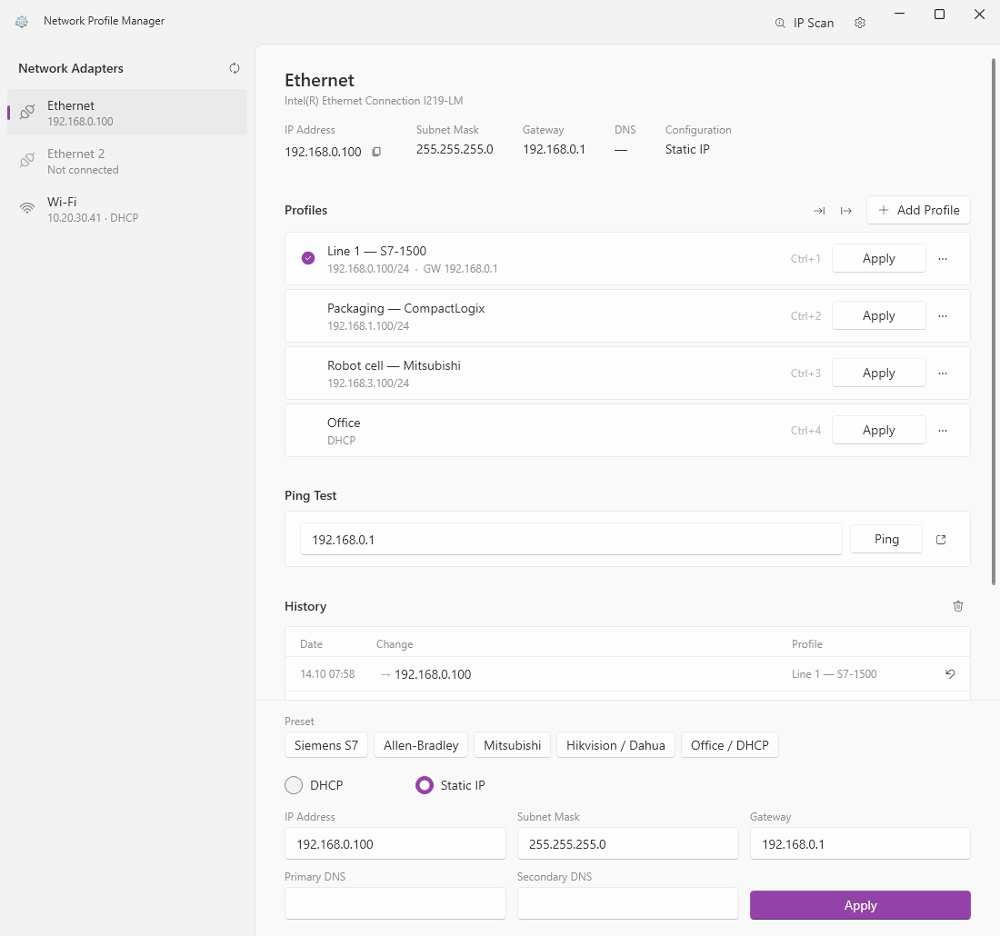
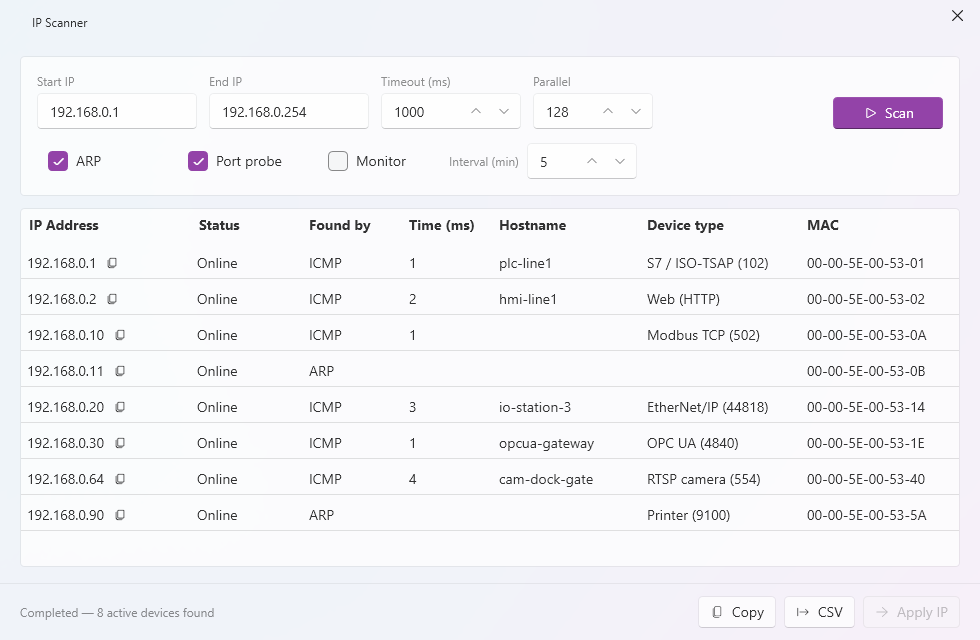

# Network Profile Manager

[](../../actions/workflows/build.yml)
[](https://dotnet.microsoft.com/)
[](https://learn.microsoft.com/dotnet/desktop/wpf/)
[](LICENSE)
[](../../releases)
[](SECURITY.md)

Save, switch, and roll back Windows network adapter IP/DNS configurations through a Fluent UI. One-click vendor presets, up to 5 named profiles per adapter, full history with one-click revert, built-in IP scanner and ping tool.

> **Windows-only.** Uses `netsh` to apply configuration. The app itself runs unelevated; it asks for administrator rights only when you apply a change — one UAC prompt per apply. Running it as administrator up front works too and skips the prompt.

---

## Who is this for?

**Field automation / industrial engineers** who hop between PLCs, HMIs, drives and IP cameras every day. Each vendor lives on its own subnet (Siemens `192.168.0.x`, Allen-Bradley `192.168.1.x`, Mitsubishi `192.168.3.x`, Hikvision `192.168.1.64`, …) and switching your laptop's adapter between them is a constant chore.

This app puts the entire flow — **scan the network, ping the target, switch your IP** — into a single window, with **named profiles** so the next time you need that exact static IP / subnet / gateway / DNS combo for a given site, it's one click:

1. **IP Scanner** — sweep a range, find which devices answer, copy their IPs to clipboard or apply directly.
2. **Ping** — verify the device is reachable before doing anything.
3. **Apply** — switch your adapter to a saved Static / DHCP profile in one click. Or save the current settings as a new profile while you're on site.
4. **Revert** — if a change broke connectivity, the last 100 configurations are one click away.

Other typical users: IT field technicians, lab/test-bench engineers, anyone running multiple isolated networks on a single Windows laptop.

---

## Features

- 🏭 **One-click vendor presets** — Siemens S7, Allen-Bradley, Mitsubishi, Hikvision / Dahua and Office / DHCP fill in a laptop address on that vendor's default subnet. A preset only fills the fields; nothing changes until you press Apply.
- 🌐 **Profile management** — up to 5 named IP profiles per adapter (Static / DHCP, IP, Subnet, Gateway, Primary/Secondary DNS). Import / export as JSON to move them between laptops.
- ⚡ **One-click apply** — apply a profile or manual settings to the active adapter instantly, or press **Ctrl+1 … Ctrl+5** to apply the selected adapter's profiles.
- ↩️ **Revert from history** — view the last 100 changes and roll back to a previous configuration with one click.
- 🔍 **IP scanner** — multi-method discovery (ARP + ICMP + TCP), so devices that block ping still show up. Reports how each host was found, its MAC, open ports and a device-type hint (Modbus, S7, EtherNet/IP, OPC UA, RTSP, printer, SMB/RDP…). Optional monitoring mode notifies you when a new device joins. CSV export.
- 📡 **Ping tool** — a continuous ping window for connectivity testing.
- 🔔 **Live notifications** — system-tray balloon when adapter IP changes or connection drops.
- 🎨 **Windows 11 look** — Fluent design with Mica and your Windows accent colour; follows the system light/dark mode, or pin Light / Dark.
- 🌍 **Bilingual** — Turkish / English / System (auto-detect). Runtime switching, persisted.
- 🪟 **System tray** — keeps running in the tray when the window is closed; optional auto-start with Windows.

---

## Screenshots

<picture>
  <source media="(prefers-color-scheme: dark)" srcset="docs/screenshots/main-dark.png">
  
</picture>

<picture>
  <source media="(prefers-color-scheme: dark)" srcset="docs/screenshots/scanner-dark.png">
  
</picture>

<sub>Invented demo data. The screenshots follow your GitHub light / dark theme.</sub>

---

## Download

1. Go to [Releases](../../releases) and grab the latest **`NetworkProfileManager-vX.X.X-win-x64.zip`**.
2. Extract anywhere (e.g. `C:\Tools\NetworkProfileManager\`).
3. Double-click `NetworkProfileManager.exe`. Windows asks for administrator permission (UAC) when you apply a change.

> If Windows SmartScreen shows an "Unknown publisher" warning → **More info → Run anyway.** The executable is currently unsigned.

### Updating

There is **no auto-updater**. Check this repo's [Releases](../../releases) page for new versions, download the latest zip, and extract it over the old folder. Your profiles live in `%LOCALAPPDATA%\NetworkProfileManager\data\` and are preserved across updates.

---

## System requirements

- Windows 10 (build 1809+) or Windows 11
- Administrator rights when applying a change (`netsh` requires them; the app requests elevation per apply)
- Self-contained build — no .NET runtime install required

---

## Build from source

```powershell
git clone https://github.com/rmzncakir/network-profile-changer.git
cd network-profile-changer
dotnet build -c Release
dotnet publish NetworkProfileManager/NetworkProfileManager.csproj `
    -c Release -r win-x64 --self-contained true -o publish
```

Output is in `publish\`.

---

## Data location

Profiles, history, and theme/language preferences live in:

```
%LOCALAPPDATA%\NetworkProfileManager\data\
├── profiles_<adapter-id>.json
├── history_<adapter-id>.json
├── scanner_settings.json
└── app_settings.json
```

To uninstall completely, delete the folder above and remove the extracted exe directory.

---

## Security

- **No netsh injection** — every netsh argument is passed via `ProcessStartInfo.ArgumentList`, never via string interpolation.
- **Strict IPv4 validation** — canonical dotted-quad form required; shorthand like `192.168.1` (which `IPAddress.TryParse` accepts as `192.168.0.1`) is rejected to prevent silent misconfiguration.
- **Adapter-name sanitization** — control characters, quotes, CR/LF, and null bytes are rejected.
- **Path-traversal sanitization** — profile/history filenames are sanitized against adapter IDs.
- **Least privilege by default** — the app runs as `asInvoker`. It elevates only to apply a
  change, batching the whole netsh sequence into a single UAC prompt. Running the app
  itself as administrator is supported and simply skips the prompt.
- **Restricted elevated worker** — the elevated helper accepts only
  `interface ip set address`, `set dns` and `add dns`. Every other command, and any
  argument containing control characters or quotes, is refused. Covered by unit tests.
- **CSV injection neutralized** — scan results include hostnames from reverse DNS, which
  an attacker can influence; fields beginning `= + - @` are escaped before export.

> **Note on install location.** Because releases ship as a zip, the app usually ends up in a
> user-writable folder. Any program already running as your user could drop a malicious DLL
> beside the executable and have it loaded when you approve the UAC prompt. Extracting to a
> location only administrators can write to (e.g. under `C:\Program Files\`) avoids this.

To report a vulnerability, see [SECURITY.md](SECURITY.md).

---

## Tests

```powershell
dotnet test NetworkProfileManager.Tests/NetworkProfileManager.Tests.csproj
```

xUnit, **188 tests**, run on every push by the build workflow. They cover input validation, the elevated worker's command whitelist, profile / history storage, CIDR formatting, Turkish / English string parity and view-model logic — about 40% line coverage of the non-UI code (Models, Services, Helpers, ViewModels). The WPF views are checked by hand.

---

## Architecture

```
NetworkProfileManager/
├── Models/         IpProfile, AdapterInfo, HistoryEntry, ScanResult, VendorPreset
├── Services/       NetworkService (netsh), Profile/HistoryRepository, IpScannerService, NetworkMonitorService
├── ViewModels/     MainViewModel, AdapterViewModel, ProfileViewModel, IpScannerViewModel
├── Views/          MainWindow, AdapterListPanel, ProfilePanel, HistoryPanel, AddProfileDialog,
│                   IpScannerWindow, PingWindow, ThemeSettingsWindow, TrayPopupWindow
├── Themes/         Styles.xaml — shared text/card styles (colours come from WPF-UI)
├── Strings/        Tr.xaml, En.xaml — UI strings bound via DynamicResource
├── Helpers/        ElevationHelper (UAC worker), AppPaths, AppSettingsStore, LanguageManager, Loc,
│                   NotificationService, StartupHelper, IpFormat, ClipboardHelper
└── Converters/     BoolToVisibility, AdapterTypeToSymbol
```

Standard MVVM. UI-independent code (Core) is covered by `NetworkProfileManager.Tests`.

---

## Contributing

PRs welcome — see [CONTRIBUTING.md](CONTRIBUTING.md). Questions and ideas go to [Discussions](../../discussions).

---

## License

[MIT](LICENSE) © rmzncakir
